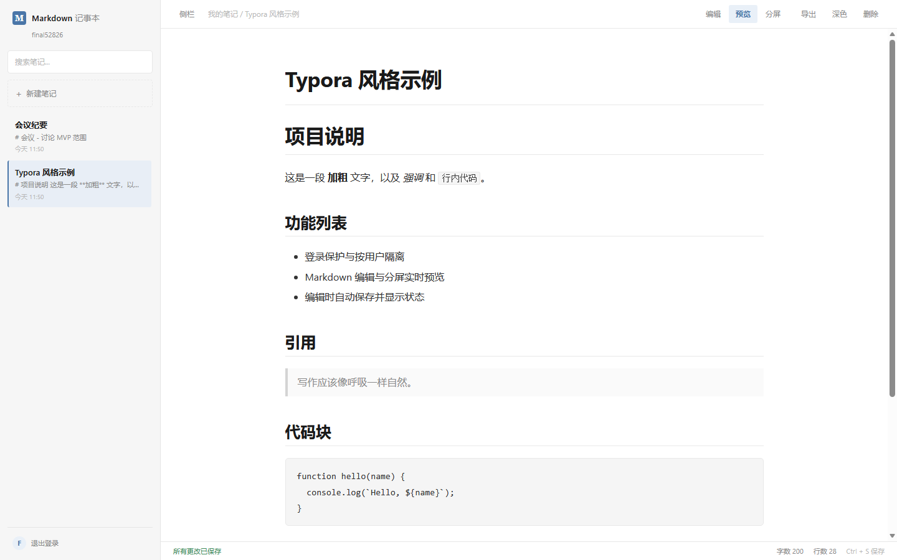
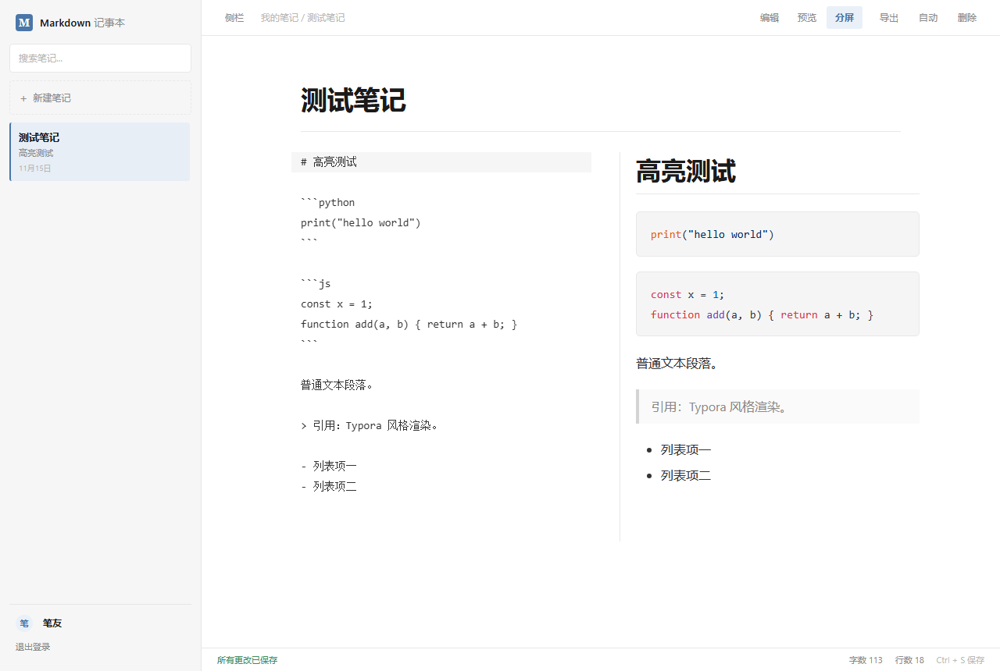
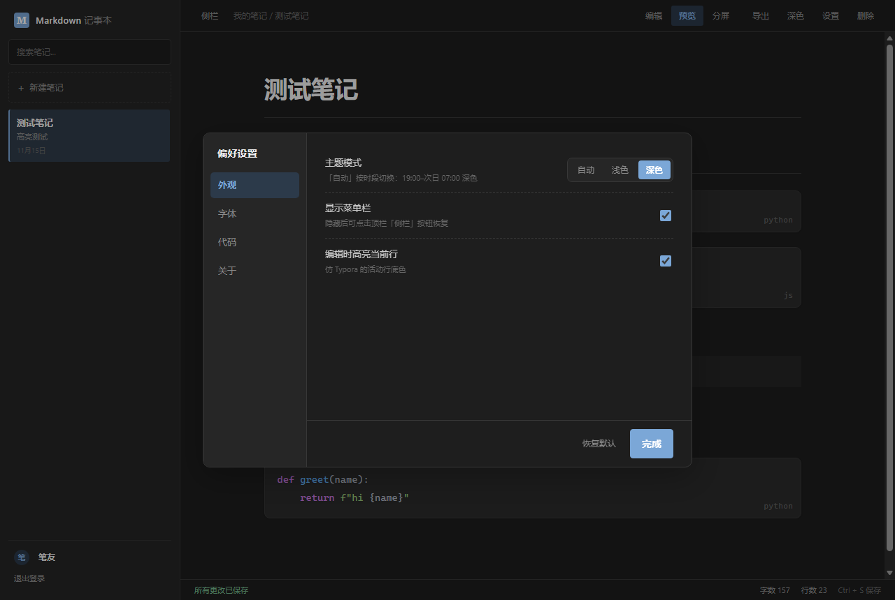
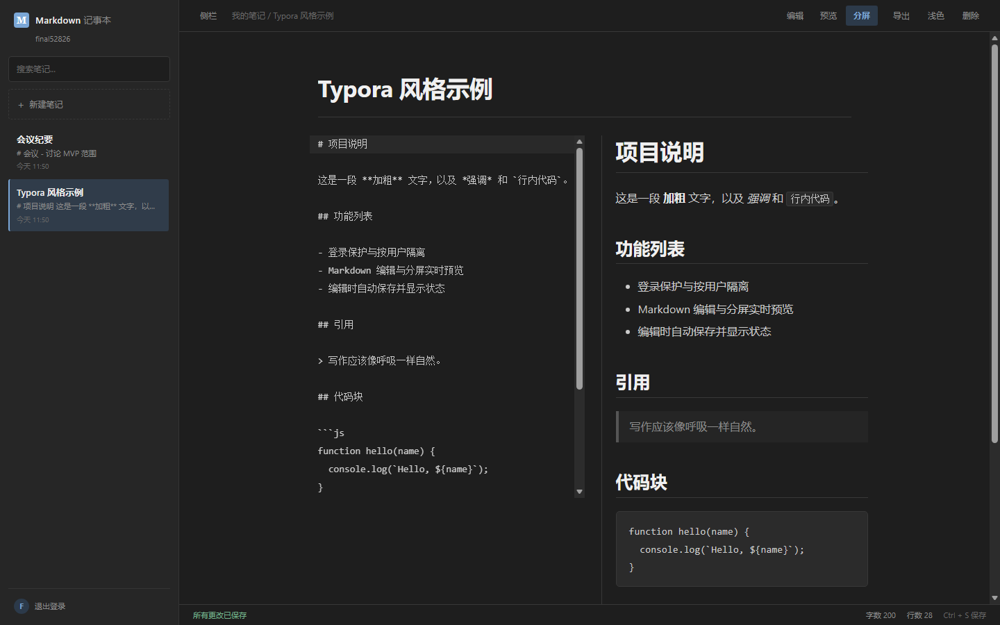
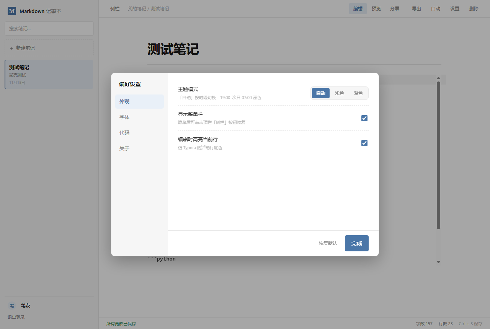
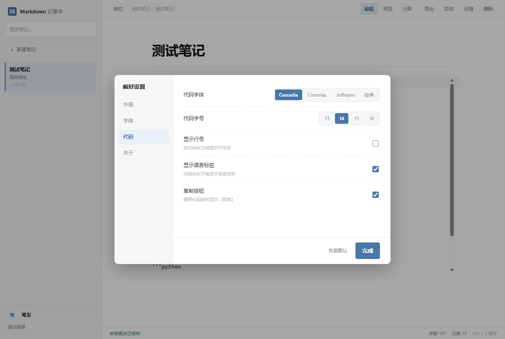
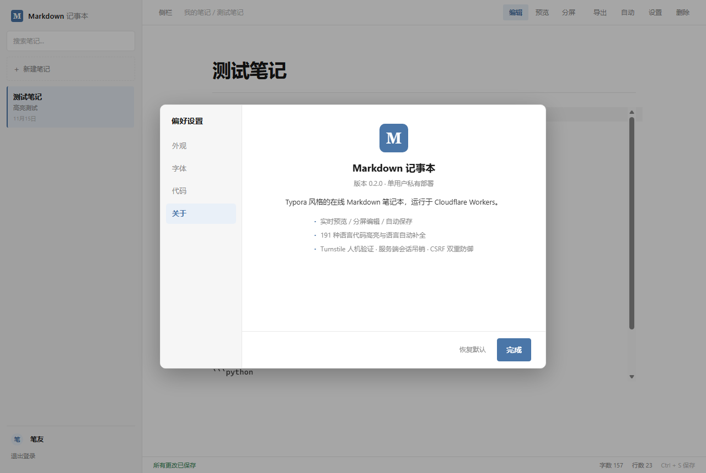
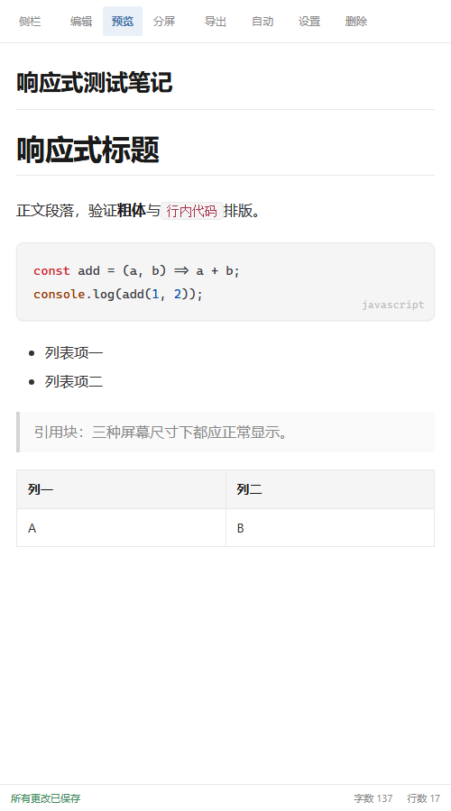
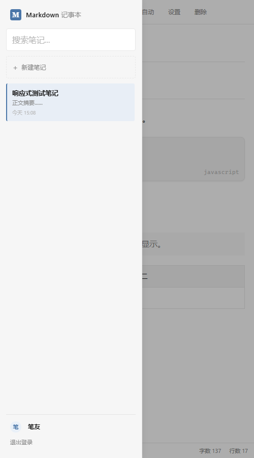
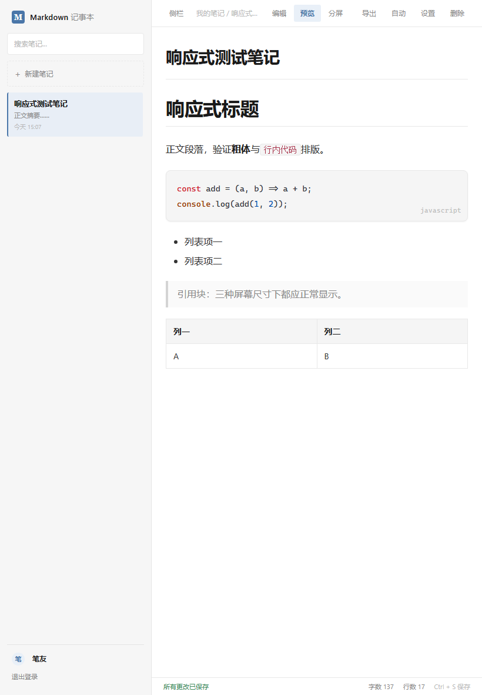

# Markdown 记事本（Cloudflare Workers）

一个可直接运行、按 Typora 视觉风格打磨的云端记事本：登录保护、笔记列表、新建/编辑/删除、标题、Markdown 编辑/预览/分屏、自动保存与保存状态，数据持久化到 D1 并按用户隔离。

> **单用户模式**：无注册功能，登录账号由 Worker 变量/密钥 `ADMIN_USERNAME` / `ADMIN_PASSWORD` 配置，可在 Cloudflare Dashboard 随时修改。
> 线上地址与账号信息不写入仓库（见本地部署记录）。部署完成后访问 `https://<worker-name>.<your-subdomain>.workers.dev`。从零搭建步骤见 [DEPLOY.md](./DEPLOY.md)。

## 1. 方案概览

```
浏览器 SPA  ──同源 JSON API──▶  Cloudflare Worker
   │                                  │
   │  marked + DOMPurify               ├─ D1：users / notes / sessions
   │  （仅前端渲染 Markdown）           ├─ KV：登录限流计数
   │                                   ├─ Turnstile：登录人机验证
   └──── Workers Static Assets ◀──────┴─ Secrets：SESSION_SECRET / ADMIN_* / TURNSTILE_SECRET_KEY
```

选择 Workers 而非 Pages 的原因：API、静态资源、鉴权与限流集中在一个部署单元，依赖最少。Markdown 原文入库、HTML 只在浏览器生成并消毒，不把不可信 HTML 写入服务端。

## 成品预览

| 登录页（含 Turnstile 人机验证） | 浅色 · 预览模式 |
| --- | --- |
|  |  |
|  |  |
|  |  |
|  |  |
| 手机 · 预览 | 手机 · 抽屉侧栏 |
|  |  |
| 手机 · 偏好设置（全屏） | Pad · 预览 |
|  |  |

## 2. 已实现功能

| 类别 | 内容 |
| --- | --- |
| 账号 | 单用户登录（凭证来自 Worker 变量/密钥）、底部自定义显示名（内联编辑，`PUT /api/auth/profile`）、退出（服务端吊销会话）、刷新保持登录 |
| 笔记 | 列表（标题/摘要/更新时间）、搜索标题与摘要、打开任意记录、新建、编辑、删除 |
| 编辑 | 标题输入、编辑/预览/分屏实时预览、代码块一键复制、导出 `.md` 文件 |
| 高亮 | highlight.js 191 种语言、随主题切换双配色（浅 GitHub / 深 One Dark）、代码块语言标签、可选行号列 |
| 补全 | Typora 式代码语言自动补全：围栏行输入即弹候选，↑↓/Enter/Esc/鼠标选择，自动配对闭合围栏 |
| 偏好设置 | Typora 风格设置弹窗（Ctrl + ,）：主题模式、显示/隐藏菜单栏、正文字体/字号/行距、代码字体/字号、行号/语言标签/复制按钮/活动行高亮，全部实时生效并持久化 |
| 保存 | 800ms 防抖自动保存、Ctrl+S 立即保存、状态提示、失败可重试、离开页提醒 |
| 界面 | Typora 风格：窄侧栏、居中纸张、精细 Markdown 排版、浅色/深色主题 + 按时段自动切换、侧栏收起、当前行高亮、字数与行数 |
| 响应式 | 手机（≤680px：抽屉侧栏 + 遮罩、顶栏自动换行、设置弹窗全屏、触控目标 ≥40px、复制按钮常显、dvh 动态视口）、Pad（≤1024px 收窄留白）、桌面三端适配 |
| 持久化 | Cloudflare D1（SQLite），按 `user_id` 强制隔离 |
| 安全 | Turnstile 人机验证、签名会话 + 服务端登记、输入校验、XSS 防护、CSP、限流、统一错误处理 |

## 3. 项目结构

```
md-notes-worker/
├── src/
│   ├── index.js        # 入口：路由、安全响应头、SPA 兜底、异常处理
│   ├── auth.js         # PBKDF2、HMAC 会话、token 摘要
│   ├── db.js           # D1 数据访问（笔记查询带 user_id，会话登记）
│   ├── validate.js     # 输入校验、请求体大小限制、HttpError
│   ├── ratelimit.js    # KV 固定窗口限流
│   └── http.js         # JSON 响应、Cookie 解析与写入、客户端 IP
├── public/
│   ├── index.html      # SPA 页面骨架（含偏好设置弹窗）
│   ├── app.js          # 鉴权/列表/搜索/自动保存/预览/分屏/导出/偏好设置/代码高亮/语言补全
│   ├── style.css       # Typora 风格主题（双主题高亮配色、字体变量体系、设置弹窗）
│   └── vendor/         # 本地化依赖，配合严格 CSP，不依赖 CDN
│       ├── marked.min.js
│       ├── purify.min.js
│       ├── highlight.min.js     # highlight.js 10.7.3 主包（39 常用语言）
│       └── hljs-extra.min.js    # 扩展 152 种语言（合计 191 种）
├── scripts/
│   ├── smoke-test.sh   # 本地端到端验证脚本（45 项断言）
│   └── github-sync.py  # Git Data API 仓库镜像同步
├── schema.sql          # D1 表结构
├── wrangler.toml       # D1 / KV / Assets 绑定
├── package.json
├── .dev.vars.example   # 本地密钥模板
├── .dev.vars           # 本地密钥（已 gitignore）
├── .gitignore
└── README.md
```

## 4. 数据模型

```sql
users (
  id INTEGER PRIMARY KEY,
  username TEXT UNIQUE,          -- 3-32 位字母数字下划线
  password_hash TEXT,            -- pbkdf2$迭代次数$salt$hash
  display_name TEXT,             -- 界面显示名（可自定义，不影响登录凭证）
  created_at INTEGER
)

notes (
  id INTEGER PRIMARY KEY,
  user_id INTEGER NOT NULL,      -- 外键 → users.id，级联删除
  title TEXT,                    -- ≤ 200 字符
  content TEXT,                  -- Markdown 原文，≤ 200 KB
  created_at INTEGER,
  updated_at INTEGER             -- 列表排序依据
)

sessions (
  token_hash TEXT PRIMARY KEY,   -- Cookie 的 SHA-256 摘要，不存原文
  user_id INTEGER NOT NULL,
  expires_at INTEGER,
  created_at INTEGER
)
CREATE INDEX idx_notes_user_updated ON notes(user_id, updated_at DESC);
CREATE INDEX idx_sessions_user ON sessions(user_id);
```

隔离策略：服务端从已验签会话取 `user_id`（不信任客户端传参），所有笔记 SQL 均带 `WHERE id = ? AND user_id = ?`。跨用户 ID 返回 404，不暴露“存在但无权”信息。

## 5. 核心实现

### 5.1 API

| 方法 | 路径 | 说明 |
| --- | --- | --- |
| POST | `/api/auth/login` | 登录（凭证与 `ADMIN_USERNAME` / `ADMIN_PASSWORD` 常量时间比对） |
| POST | `/api/auth/login` | 登录，下发会话 Cookie 并登记会话 |
| POST | `/api/auth/logout` | 删除服务端会话登记并清除 Cookie，旧 Cookie 立即失效 |
| GET | `/api/auth/me` | 恢复当前登录态（含 display_name） |
| PUT | `/api/auth/profile` | 修改自定义显示名（1-32 字符，去首尾空白，禁控制字符） |
| GET | `/api/notes` | 当前用户笔记摘要列表 |
| POST | `/api/notes` | 新建笔记 |
| GET | `/api/notes/:id` | 读取单条笔记 |
| PUT | `/api/notes/:id` | 更新标题/内容（自动保存调用） |
| DELETE | `/api/notes/:id` | 删除笔记 |

统一返回 `{ ok: true, data }` / `{ ok: false, error: { code, message } }`。

### 5.2 鉴权

- 密码：`crypto.subtle` PBKDF2-SHA256，10 万次迭代 + 16 字节随机盐，常量时间比较。
- 用户不存在时执行一次等成本派生，降低用户名枚举的时序差异。
- 会话：`base64url(payload).base64url(HMAC-SHA256)`，负载含 `sub/u/iat/exp`，用 `crypto.subtle.verify` 验签；有效期 7 天。
- 服务端登记：只存 Cookie 的 SHA-256 摘要；每次鉴权查 `sessions` 表，登出即删记录，因此登出后旧 Cookie 不能继续使用。登录时顺带清理过期登记。
- Cookie：`HttpOnly` + `SameSite=Lax` + 始终 `Secure` + `Path=/` + `Max-Age`；前端 JS 无法读取。

### 5.3 自动保存与编辑

输入框 `input` 事件标记待保存并重置 800ms 定时器；到期调用 `PUT /api/notes/:id`。保存串行化，成功更新列表摘要与时间戳，失败保留待保存状态并可点击重试。切换笔记/登出时先冲刷未保存内容，`beforeunload` 做离开提示。

分屏模式下源码与渲染结果并排，输入即刷新右侧预览；预览区每个代码块带悬停显示的复制按钮；「导出」把当前笔记保存为 `<标题>.md`。

### 5.4 Markdown XSS 防护（纵深）

1. 服务端只存 Markdown 原文，不接收、不拼接、不返回 HTML。
2. 浏览器端 `marked.parse()` 生成 HTML 后立即 `DOMPurify.sanitize()`（HTML profile，禁用 `style/form/input/iframe/object/embed` 等标签与 `style` 属性）。
3. DOMPurify 钩子把 `<a>` 统一加上 `target="_blank"` 与 `rel="noopener noreferrer"`。
4. Worker 全局 CSP：`default-src 'self'; script-src 'self'; object-src 'none'; base-uri 'none'; frame-ancestors 'none'; connect-src 'self'`，即使消毒被绕过，内联脚本也无法执行。
5. 笔记标题/摘要使用 `textContent` 渲染，不进入 `innerHTML`。

### 5.5 限流与错误处理

- Turnstile 人机验证：登录前必须通过（token 服务端 siteverify 校验，单次有效、300 秒过期）；SITE_KEY 与 SECRET_KEY 须同时配置才启用，只配一个按未启用处理，避免锁死登录。
- CSRF 双防线：API 强制 `application/json`（跨站简单请求无法伪造该类型，浏览器会拦截预检）+ 写请求 Origin 同源校验（无 Origin 的 API 直连不受影响）+ `SameSite=Lax` Cookie。
- KV 固定窗口：登录 10 次/分钟（按 `CF-Connecting-IP`），超限返回 429 + `Retry-After`。KV 故障时放行并记录日志，避免锁死登录。
- 请求体校验：`Content-Length` 与实际字节双重限制 256 KB；笔记内容 200 KB、标题 200 字符。
- 统一 `try/catch`：业务错误返回对应 4xx，未知异常只返回 500 通用文案，堆栈仅写服务端日志。

## 6. 本地运行

前置：Node.js ≥ 22.12（wrangler v4 要求）。

```bash
cd md-notes-worker
npm install
# .dev.vars 已提供本地随机密钥；如需自定义，按 .dev.vars.example 修改
npm run db:init:local
npm run dev
```

打开 `http://localhost:8787`，用 `.dev.vars` 中的 `ADMIN_USERNAME` / `ADMIN_PASSWORD` 登录（本地默认 `admin` / `LocalDev-Passw0rd-2026`）。

> `.dev.vars` 含本地密钥，已加入 `.gitignore`。部署前必须重新生成生产密钥，不要复用本地值。

## 7. 部署要点

> 完整的从零部署图文步骤（含 API Token 权限、GitHub Secrets、两种部署方式、验证清单与排错）见 **[DEPLOY.md](./DEPLOY.md)**。下面是指令速查。

1. 创建资源并回填 `wrangler.toml`：
   ```bash
   npx wrangler d1 create md-notes-db
   npx wrangler kv namespace create RATE_LIMIT
   ```
   把输出的 `database_id` / `id` 替换掉文件中的占位 UUID。
2. 初始化远端表（含 `sessions`）：`npm run db:init:remote`
3. 写入密钥（不要写进 `wrangler.toml` 或代码仓库）：
   ```bash
   npx wrangler secret put SESSION_SECRET   # 随机 ≥32 字符
   npx wrangler secret put ADMIN_USERNAME   # 登录用户名
   npx wrangler secret put ADMIN_PASSWORD   # 登录密码（强密码 ≥8 字符）
   npx wrangler secret put TURNSTILE_SECRET_KEY   # Turnstile 密钥（site key 已在 wrangler.toml [vars]）
   ```
   也可在 Dashboard → Worker → Settings → Variables and Secrets 中添加/修改，改后立即生效，无需重新部署。
4. 部署：`npm run deploy`。脚本固定带 `--keep-vars` —— `wrangler deploy` 默认会清空 Dashboard 上的变量，不带该参数会丢配置。
5. 端到端验证：打开 `<worker>.workers.dev`，用配置的管理员凭证登录 → 新建 → 编辑 → 刷新确认内容与登录态保留 → 退出后用旧会话确认 401 → 预览确认 Markdown 渲染。不要只以“部署命令成功”为准。

## 8. 安全设计汇总

| 风险 | 措施 | 边界 / 说明 |
| --- | --- | --- |
| 未授权访问 | 全部笔记接口校验签名会话 + 服务端登记 | 过期或已登出会话立即失效 |
| 越权读取/篡改 | SQL 层强制 `user_id` 条件 | 跨用户返回 404 |
| 密码泄露 | PBKDF2 + 随机盐 + 常量时间比较 | 生产必须强随机 `SESSION_SECRET` |
| 会话伪造/窃取 | HMAC 验签、HttpOnly、Secure、SameSite=Lax、库内只存摘要 | 支持单会话吊销，不做全设备强制登出 |
| 凭证泄露 | `ADMIN_PASSWORD` 为 secret 不入库；改动只需在 Dashboard 更新，立即生效 |
| 暴力破解 | Turnstile 人机验证 + 登录限流双重拦截 |
| CSRF | application/json 强制 + Origin 同源校验 + SameSite=Lax |
| 消毒库过期 | DOMPurify 3.4.18（含 CVE-2026-65914/49458/75838 修复）+ marked 15.0.12，本地 vendor 化 |
| Markdown XSS | DOMPurify + 本地依赖 + CSP | CSP 的 `style-src` 含 `unsafe-inline` |
| 超大请求 | Content-Length + 实际字节双重校验 | 单笔记 200 KB |
| 信息泄露 | 通用错误文案、堆栈不入响应 | 日志保留在 Worker |
| 密钥泄漏 | `.dev.vars` gitignore + Dashboard secret | 提交前需再次扫描仓库 |

## 9. MVP 边界与后续建议

当前刻意不做：邮件验证/密码找回、细粒度角色、版本历史、附件上传、精确限流（Durable Objects）、完整行内所见即所得编辑。

已完成的迭代项：会话服务端吊销、笔记搜索、分屏实时预览、Markdown 导出、代码块复制、底部自定义显示名、191 语言代码高亮、Typora 式语言自动补全、按时段自动深浅色、偏好设置弹窗（菜单栏显隐/字体/行号/语言标签等）。

按优先级建议继续：Turnstile 接入登录 → 版本历史与回收站 → 富文本行内编辑。

## 10. 界面说明（Typora 风格）

视觉参照 Typora：左侧 258px 文件栏（选中项左侧蓝线）、顶部搜索框、中间最大 880px 的居中纸张、34px 大标题与细分割线、标题下划线、引用块灰底竖线、代码块浅底圆角、底部 30px 状态栏。默认浅色纸张，右上角主题按钮三态循环「自动 → 浅色 → 深色」，「自动」按时段切换（19:00–次日 07:00 深色）并每分钟复查；「侧栏」按钮可收起文件栏进入专注书写。

**偏好设置**（右上角「设置」按钮或 `Ctrl + ,`）：左导航 + 右面板，外观（主题模式、显示/隐藏菜单栏、当前行高亮）、字体（正文无衬线/衬线/系统、字号 15-18、行距）、代码（Cascadia/Consolas/JetBrains/经典、字号 13-16、行号、语言标签、复制按钮）、关于。所有设置实时生效并写入 `localStorage`，提供「恢复默认」。

**代码显示**：highlight.js 10.7.3 全量 191 种语言本地 vendor 化；浅色 GitHub 配色、深色 One Dark 配色随主题切换；代码块 8px 圆角 + 语言标签芯片；行内代码主题色着色。

模式：编辑（源码 + 当前行高亮）、预览（Typora 式排版）、分屏（两者并排，输入即刷新）。完整行内所见即所需维护光标与富文本块的双向映射，风险高于收益，故未采用。

## 11. 验证结果

本地已实际运行验证：

- `bash scripts/smoke-test.sh`：单用户模式 45 项全部通过，覆盖 D1 初始化、登录成功/失败路径、注册端点移除（404）、未登录 401、新建、编辑持久化、删除、自定义显示名（401/400/200/持久化）、静态资源（含高亮脚本与设置弹窗元素）、Cookie 属性、CSP，以及登出后旧 Cookie 失效、另一会话不受影响。
- 无头 Edge 端到端：登录态、预览高亮、底部层叠显示名、语言补全弹窗（过滤/键盘选择/自动闭合围栏/Esc 关闭/非围栏行不弹）、偏好设置全流程（面板切换、字号/行号/语言标签/菜单栏显隐实时生效、localStorage 持久化、主题 seg 联动、恢复默认）共 18 项断言通过；界面截图见上方「成品预览」。
- Markdown 消毒：`<script>` / `onerror` / `javascript:` URL 均被清除，脚本未执行，标题正常渲染（`PWNED=0|SCRIPT=0|ONERROR=0|JSURL=0|H1=1`）。

验证过程中发现并修复两个真实缺陷：`ratelimit.js` 中 `count` 变量作用域错误导致登录 500；分屏模式遗漏切换布局 class 导致并排布局未生效。
